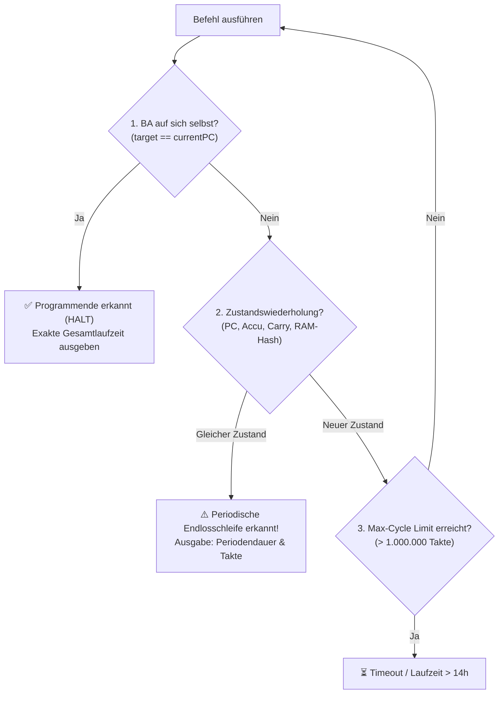

# ⚡ CLACK-STUDIO
**16-Bit Relay Computer Visual Hardware Lab & Emulator (Svelte 5 + Go)**

`clack-studio` ist ein eigenständiger visueller Hardware-Simulator, Assembler, Compiler und Debugger für den 16-Bit Relaisrechner mit modernem **Svelte 5 + Vite Web-Frontend**, **CodeMirror 6 BASIC & Assembler IDE**, 64×64 / 32×32 Multi-Color LED Matrix Display, Frontpanel-LEDs, Logic Analyzer, zyklengenauer Relais-Akustik und Arduino-Flasher.

---

## ✨ Features (v2.5.2)

### 1. ⏱️ Cycle-Accurate Timing & Hardware-Metriken (Neu in v2.5.1)
* **Befehlsgenaue Takt-Gewichtung:**
  * `NOP`: 1 Takt (~50 ms)
  * `LDA #imm`, `ADD #imm`, `AND`, `OR`, `NOT`, `SHR`, `SHL`, `BA`, `BC`, `BN`, `BE`, `BZ`, `RET`: 2 Takte (~100 ms)
  * `LDAM addr`, `STAM addr`, `CALL addr`: 3 Takte (~150 ms)
  * `LDAMM [ptr]`, `STAMM [ptr]`: 4 Takte (~200 ms)
* **Differenzierte Zähler:**
  * `BEFEHLE`: Anzahl logisch ausgeführter Befehlsschritte.
  * `CYCLES`: Exakte Summe der physikalischen Hardware-Maschinentakte.
  * `RELAIS-ZEIT`: Reale Ausführungszeit auf 20 Hz Relais-Hardware ($50\,\text{ms}$ pro Hardware-Takt).
* **Logic Analyzer:** Neue Spalte `Takte` (`+N`) für jeden Einzelschritt + zyklengenauer CSV-Export.

### 2. 🎨 Multi-Color LED-Matrix Display (Neu in v2.5.2)
* **64×64 (Full Framebuffer):** Memory-Mapped ab `0x0300` (768..1023).
* **32×32 (4x Hardware Matrix):** Memory-Mapped ab `0x03C0` (960..1023).
* **5 Hardware-Farbpaletten:**
  * 🔥 **Mandelbrot Flame / Heatmap:** 16-Stufen Farbverlauf (ideal für Fraktale).
  * 🎨 **16-Farben Hardware RGB:** Authentische PICO-8 / Retro CGA-Farbpalette.
  * 🌆 **Cyberpunk Neon:** Leuchtendes Pink, Cyan und Electric Blue.
  * 🌈 **Regenbogen-Spektrum:** 16-Stufen Spektralfarben.
  * 💡 **Klassisch Monochrom:** Bernstein, Phosphor-Grün, Cyan, Rubin.
* **4-Bit Nibble Mode:** 16 echte RGB-Farben pro Pixel direkt aus dem RAM (4 Pixel pro 16-Bit-Wort).
* **High-Performance Engine:** Direct-Rendering in $<1\,\text{ms}$ bei 60 FPS.

### 3. 📥 Universeller C/C++ & VHDL Array-Importer (Neu in v2.5.0)
* **Multi-Format Parser:** Liest `daten[n] = 0x...;`, C99 `[n] = 0x...`, Array-Blöcke `{ 0x1400, ... }`, `.ino` Sketches, VHDL ROMs `(n => x"...")` und Memory Dumps per Drag & Drop oder Copy-Paste.
* **Presets:** Vorkonfigurierter **151-Wort Integer Division & Software PI Algorithmus** und Dijkstra-Routing.
* **Erweiterte Konvertierung:** 1-Klick-Wechsel zwischen C-Array (`daten[n] = ...;`) und Arduino-Loader (`addr val`).

### 4. ⚡ Assembler Studio & Zwei-Wege-Decompiler
* **Assembler Studio:** 16-Bit Relais-Assembler (`LDA`, `LDAM`, `STAM`, `ADD`, `BA`, `BZ`, `CALL`, `RET`, etc.) mit CodeMirror 6 Syntax-Highlighting und Direkt-Simulation.
* **Auto-Disassembler:** Wandelt rohen Maschinencode mit automatischer Sprungziel- und Subroutinen-Erkennung (`SUB_xxx`, `LABEL_xxx`) und Erhalt aller Kommentare in lesbaren Assembler um.
* **Assembler-to-BASIC Decompiler:** 1-Klick-Rückübersetzung von Maschinencode $\rightarrow$ strukturierten BASIC-Quellcode.

### 5. 💻 Modernes Svelte 5 + Go Single-Binary Frontend
* **Zero Virtual DOM Overhead:** Native Reaktivität mit Svelte 5 Runes (`$state`, `$derived`).
* **Standalone Single-Binary:** Das gesamte Frontend ist per `//go:embed` fest in die Go-Binary einkompiliert.
* **USB-Flasher:** Direktes Flashen auf den Arduino Mega Speicher-Controller aus dem Browser via Web-Serial / API.

---

## 🔬 Laufzeit-Berechnung & Halteproblem-Erkennung

Da der 16-Bit Relaisrechner eine mechanische Hardware mit diskreten Schaltzeiten ist, unterscheidet Clack Studio zwischen **moderner Simulations-Geschwindigkeit (bis zu 500.000+ Befehle/s)** und der **echten physikalischen Hardware-Laufzeit (20 Hz / 50 ms pro Takt)**.

### 1. Physikalische Takt- & Zeit-Kalkulation
Jeder Befehl wird anhand seiner tatsächlichen Bus- und Speicher-Microzyklen gewichtet:

| Befehlstyp | Assembler-Beispiele | Benötigte Micro-Takte | Reale Hardware-Dauer (20 Hz) |
| :--- | :--- | :---: | :---: |
| **1-Wort intern** | `NOP`, `NOT`, `SHR`, `SHL`, `HALT` | **1 Takt** (1× Opcode-Fetch) | **50 ms** |
| **2-Wort Immediate & Branch** | `LDA #100`, `ADD #1`, `BA 400`, `BZ 83`, `RET` | **2 Takte** (Opcode + Operand/Sprungziel) | **100 ms** |
| **Direkter Speicherzugriff** | `LDAM 200`, `STAM 200`, `CALL 300` | **3 Takte** (Opcode + Zieladresse + RAM Read/Write / Stack) | **150 ms** |
| **Indirekter Speicherzugriff** | `LDAMM [200]`, `STAMM [200]` | **4 Takte** (Opcode + Pointer + Effektivadresse + RAM R/W) | **200 ms** |

$$\\text{Relais-Laufzeit} = \\sum (\\text{Befehlstakte}) \\times 0{,}050\,\\text{s}$$

---

### 2. Methoden zur Erkennung von Programmende & Endlosschleifen (Lösung des Halteproblems)

Beim Vorausberechnen von Programmlaufzeiten greift das mathematische **Halteproblem (Alan Turing, 1936)**: *Ein statisches Vorhersagen, ob ein beliebiges turing-vollständiges Programm jemals anhält, ist unmöglich.* 

Im Clack-Emulator wird das Problem durch **drei deterministische Hardware-Heuristiken** gelöst:



#### A. Hardware-Halt Erkennung (`Self-Branch Heuristik`)
Auf einem diskreten Relaisrechner ohne dedizierten `HLT`-Pin enden Programme typischerweise mit einem unbedingten Sprung auf sich selbst:
```c
daten[4] = 0x4000; // BA 4 (Ende)
daten[5] = 4;
```
Der Emulator prüft bei jedem Sprung: `if (target == currentPC) -> HALT!`. Das reguläre Programmende wird sofort nach dem letzten echten Befehl erkannt.

#### B. Zustands-Fingerabdruck & Zyklenerkennung (State-Hashing nach Brent/Floyd)
Da der Relaisrechner einen endlichen Zustandsraum besitzt ($1.024 \times 16\text{-Bit RAM} + \text{PC} + \text{ACCU} + \text{Flags} + \text{Stack}$):
- Kommt das Programm an derselben Programmzeile (`PC`) mit **exakt demselben Akku-Wert, denselben Flags und demselben RAM-Fingerabdruck** an, ist das System deterministisch in einer **periodischen Endlosschleife** gefangen.
- Clack Studio berechnet laufend einen schnellen Hash des Systemzustands und erkennt Endlosschleifen sofort unter Angabe der **Periodendauer (Takte pro Schleifendurchlauf)**.

#### C. Sicherheits-Grenze (Max-Cycle Guard)
Für extrem rechenintensive Algorithmen (wie das Apfelmännchen / Fraktale mit vielen Millionen Takten) bricht die Hintergrund-Analyse nach einer konfigurierbaren Obergrenze (z. B. $1.000.000\,\text{Takte} \approx 13{,}8\,\text{Stunden Relaiszeit}$) mit einer klaren Laufzeit-Schranke ab.

---

## 🚀 Starten & Ausführen

```bash
# Vorkompilierte Binary starten (Port 8080):
./bin/clack-studio

# Oder direkt mit Go:
go run . -port 8080
```

Öffne anschließend **`http://localhost:8080`** im Browser.

---

## 📦 Multi-Platform Binaries

Unter den [Releases auf Forgejo](https://git.latentforge.dev/relay-computing/clack-studio/releases):
- 🐧 **Linux (x86_64):** `clack-studio-linux-amd64`
- 🪟 **Windows (x64):** `clack-studio-windows-amd64.exe`
- 🍏 **macOS Apple Silicon (ARM64):** `clack-studio-darwin-arm64`
- 🍏 **macOS Intel (x64):** `clack-studio-darwin-amd64`

---

## 🛠️ Für Entwickler

```bash
cd frontend

# Dev-Server mit Hot-Module-Reloading (HMR):
npm run dev

# Frontend neu bauen:
npm run build
```
