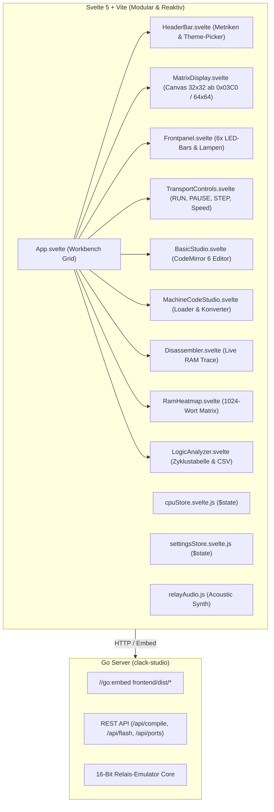

# 🏛️ Architektur, Svelte 5 & Go Single-Binary

Clack-Studio ist als hybrides System aus einem extrem schnellen Go-Backend und einem modernen, reaktiven Svelte 5 Frontend aufgebaut.

---

## 1. Architekturübersicht

---

## 2. Warum Svelte 5?

* **Zero Virtual DOM Overhead:** Svelte 5 verwendet native `$state`-Runes. Bei 60 Hz Simulation wird kein virtueller Baum verglichen, sondern exakt die geänderten LEDs im DOM aktualisiert.
* **CodeMirror 6:** Vollwertiger BASIC-Editor mit Syntax-Highlighting für Schlüsselwörter (`LET`, `IF`, `FOR`, `CLS`, `PSET`, `REM`), Zahlen und Kommentare.
* **Single-Binary:** Alle kompilieren Frontend-Dateien (`frontend/dist`) sind per `//go:embed` fest in die Go-Binary eingebettet.
