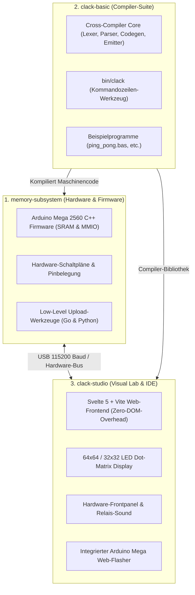

# 🌐 Das 16-Bit Relais-Computer Ökosystem

Das Relais-Computing-Projekt ist in **3 eigenständige, perfekt aufeinander abgestimmte Repositories** unterteilt:

---

## 🏛️ Rollenverteilung

1. **`memory-subsystem` (Hardware & Firmware):**
   * Stellt den 1024-Wort RAM für den physischen Relaisrechner über 41 GPIO-Leitungen bereit.
   * Empfängt Maschinencode über USB mit 115200 Baud.
   * Überträgt Framebuffer-Änderungen an das 4-Display LED-Matrix-Subsystem.

2. **`clack-basic` (Compiler-Suite):**
   * Übersetzt menschenlesbaren BASIC-Code in optimierten 16-Bit Relais-Maschinencode.
   * Bietet ein mächtiges Standalone-CLI (`clack compile`, `clack flash`, `clack run`).

3. **`clack-studio` (Visual Hardware Lab & IDE):**
   * Die All-in-One Entwicklungs- und Simulationsumgebung im Browser.
   * Visualisiert alle Register, Busse und Displays live und flasht auf Knopfdruck auf die echte Hardware.
